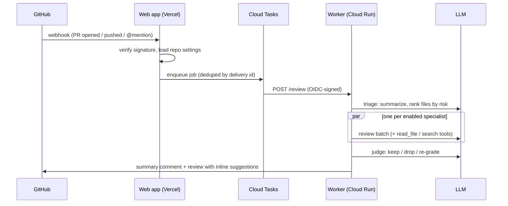

<div align="center">

# 🐇 OwnRabbit

**Open-source AI code review for GitHub pull requests.**
A self-hostable CodeRabbit alternative: a team of specialist agents reads your diff, investigates the codebase, and posts only the comments worth reading.

[](https://github.com/imtiyazakiwat/ownrabbit/actions/workflows/ci.yml)
[](CONTRIBUTING.md)
[](package.json)

[**Install the GitHub App**](https://github.com/apps/ownrabbit) · [Dashboard](https://ownrabbit.vercel.app) · [Self-host](#self-hosting) · [Contribute](CONTRIBUTING.md)

</div>

---

## Why OwnRabbit

Most AI reviewers flood pull requests with generic advice. OwnRabbit is built around one idea: **signal over volume**.

- **Multi-agent review.** Security, correctness, performance, maintainability, and test specialists run in parallel, each with a focused brief.
- **Agentic investigation.** On standard and deep settings, reviewers read callers, types, and configs in a sandboxed checkout before commenting.
- **A judge pass.** A final stage removes speculative, duplicate, and wrong findings.
- **Inline, one-click fixes.** Findings land on the exact lines as GitHub suggestion blocks.
- **Incremental reviews.** New pushes are reviewed against the last reviewed commit, not from scratch.
- **Per-repo control.** Trigger mode, depth, which agents run, comment budget, severity floor, path filters, and plain-English house rules, all from a dashboard.
- **Prompt-injection aware.** PR content is treated as untrusted data and never as instructions.
- **Bring your own model.** Any OpenAI-compatible endpoint. Defaults to Gemini.

## How it works



| Stage | What it does |
| --- | --- |
| **Triage** | A fast model summarizes the PR and ranks files high / medium / low / skip. |
| **Specialists** | Each enabled reviewer gets the diff with real line numbers and its own focus. |
| **Investigate** | Reviewers call `read_file`, `search`, and `list_dir` against a read-only checkout (git hooks and LFS disabled). |
| **Anchor** | Findings are validated against the diff so GitHub accepts every inline comment. |
| **Judge** | Drops noise and duplicates, may lower overstated severity. |
| **Publish** | One summary comment (updated in place) and one review per run. |

## Usage

Once the app is installed on a repository:

| Comment | Effect |
| --- | --- |
| `@ownrabbit` or `@ownrabbit review` | Review commits pushed since the last review |
| `@ownrabbit full review` | Re-review the entire PR |
| `@ownrabbit check the auth flow` | Full review with your note as extra focus |

Only repository owners, members, and collaborators can trigger reviews by mention.

## Repository layout

```
apps/
  web/        Next.js dashboard, GitHub OAuth, webhook → Cloud Tasks   (Vercel)
  worker/     Review engine: triage, agents, judge, publish            (Cloud Run)
packages/
  core/       Shared settings schema, trigger rules, Firestore + GitHub clients
scripts/
  create-github-app.mjs   One-click GitHub App registration via manifest
```

## Self-hosting

You need a GCP project (Firestore, Cloud Run, Cloud Tasks, Secret Manager), a Vercel account, and an OpenAI-compatible LLM endpoint.

1. **Clone and install**
   ```bash
   git clone https://github.com/imtiyazakiwat/ownrabbit && cd ownrabbit
   pnpm install
   ```
2. **Provision GCP**: enable the APIs, create a Firestore (native) database, a Cloud Tasks queue, and three service accounts (`worker`, `invoker`, `web`). See [docs/self-hosting.md](docs/self-hosting.md) for the exact commands.
3. **Deploy the worker**
   ```bash
   pnpm --filter @ownrabbit/worker build
   gcloud run deploy ownrabbit-worker --source=apps/worker/dist --no-allow-unauthenticated ...
   ```
4. **Register your GitHub App**
   ```bash
   node scripts/create-github-app.mjs https://your-app.vercel.app "Your Bot Name"
   ```
5. **Deploy the web app** to Vercel with root directory `apps/web` and the variables in [`.env.example`](.env.example).

## Local development

```bash
pnpm install
pnpm test          # unit + pipeline tests (vitest)
pnpm typecheck     # all packages
pnpm dev:web       # http://localhost:3000
```

The worker's pipeline is fully testable without network access: see `apps/worker/src/orchestrator.test.ts` for fakes of GitHub and the LLM.

## Roadmap

- [ ] Learnings: remember feedback when users resolve or reject comments
- [ ] `.ownrabbit.yaml` in-repo config that overrides dashboard settings
- [ ] Reply-to-comment conversations
- [ ] GitLab and Bitbucket support
- [ ] Usage and cost dashboard per repo

Ideas and feedback are welcome in [Discussions](https://github.com/imtiyazakiwat/ownrabbit/discussions) or [Issues](https://github.com/imtiyazakiwat/ownrabbit/issues).

## Contributing

Contributions of all sizes are welcome. Start with [CONTRIBUTING.md](CONTRIBUTING.md), and look for issues labeled [`good first issue`](https://github.com/imtiyazakiwat/ownrabbit/labels/good%20first%20issue).

## Security

Please report vulnerabilities privately. See [SECURITY.md](SECURITY.md).

## License

The license is being finalized. Until a `LICENSE` file is added, all rights are reserved by the authors.
